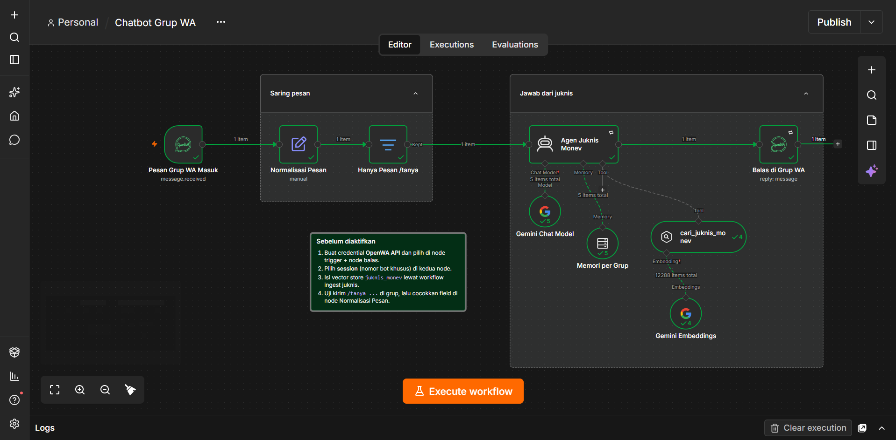

# n8n WA Group RAG Bot

Workflow [n8n](https://n8n.io) untuk chatbot grup WhatsApp yang menjawab pertanyaan **hanya berdasarkan dokumen juknis/SOP** melalui RAG (Retrieval-Augmented Generation). Setiap jawaban menyertakan rujukan dokumen. Jika jawabannya tidak ada di dokumen, bot menolak menjawab dan tidak menebak.



## Cara kerja

1. **Pesan Grup WA Masuk**: trigger OpenWA menerima pesan. Filter di sisi trigger hanya meloloskan pesan teks dari grup yang bukan dikirim oleh bot sendiri.
2. **Normalisasi Pesan**: merapikan payload OpenWA menjadi `chatId`, `messageId`, `sender`, `body`, dan `question` (teks setelah `/tanya`).
3. **Hanya Pesan /tanya**: gerbang pemicu. Bot hanya merespons pesan berawalan `/tanya` (tidak peka huruf besar/kecil) yang memiliki isi pertanyaan, sehingga tidak menyela obrolan biasa.
4. **Agen Juknis Monev**: agen LangChain dengan model Gemini (temperature 0,2) yang wajib memanggil tool pencarian pada iterasi pertama. Memori percakapan dipisah per grup (6 pesan terakhir).
5. **cari_juknis_monev**: tool vector store (top-K = 5) yang mengembalikan potongan juknis beserta metadata dokumen/bagian.
6. **Balas di Grup WA**: membalas dengan mengutip pesan asal. Memakai `idempotencyKey` dan retry 3x agar balasan tidak terkirim ganda saat terjadi kegagalan.

### Perilaku agen (system prompt)

- Selalu mencari di juknis sebelum menjawab, tanpa memakai pengetahuan umum.
- Jika ditemukan: jawaban maksimal 5 kalimat, bahasa Indonesia formal, ditutup baris `Rujukan: <dokumen/bagian>`.
- Jika tidak ditemukan: membalas kalimat penolakan baku, tanpa menebak.
- Tidak memberi keputusan atas sanggah, hanya menjelaskan prosedur.
- Keluaran teks polos (tanpa markdown) agar tampil benar di WhatsApp.

## Prasyarat

| Komponen | Keterangan |
|---|---|
| n8n | Versi yang mendukung node AI Agent v3.x (impor akan gagal atau node tampil tidak dikenal pada versi lama) |
| Community node [`@rmyndharis/n8n-nodes-openwa`](https://www.npmjs.com/package/@rmyndharis/n8n-nodes-openwa) | Harus dipasang terlebih dahulu |
| OpenWA | Server yang berjalan, dengan satu session untuk nomor bot khusus |
| Google Gemini API key | Dipakai untuk model chat dan embeddings |
| Dokumen juknis/SOP | Sumber pengetahuan bot, akan di-ingest ke vector store |

## Instalasi

1. Pasang community node OpenWA di n8n (*Settings → Community Nodes*).
2. Impor `workflows/chatbot-grup-wa.json` (*Workflow → Import from File*).
3. Buat credential **OpenWA API** dan **Google Gemini (PaLM) API**, lalu pilih pada node yang bertanda merah.
4. Pilih **session** OpenWA pada node trigger dan node balasan.
5. Isi vector store (lihat bagian berikut).
6. Kirim `/tanya <pertanyaan>` di grup uji. Periksa hasil eksekusi pertama dan cocokkan field di node **Normalisasi Pesan** jika payload OpenWA Anda berbeda.
7. Aktifkan workflow.

## Mengisi vector store

Workflow ini hanya **membaca** dari vector store. Pengisiannya dilakukan oleh workflow terpisah (`workflows/ingest-juknis.json`) dengan syarat berikut agar kompatibel:

- `memoryKey` harus **`juknis_monev`**, sama dengan yang dipakai node `cari_juknis_monev`.
- Model embeddings harus **sama** (Gemini Embeddings). Embeddings yang berbeda akan menghasilkan pencarian yang tidak relevan tanpa pesan error.
- Sertakan metadata nama dokumen/bagian pada setiap potongan teks, karena baris `Rujukan:` bergantung padanya.

## Keterbatasan dan risiko

- **Vector store in-memory tidak persisten.** Data hilang saat n8n restart, dan bot akan menjawab "belum diatur" untuk semua pertanyaan sampai ingest dijalankan ulang. Untuk produksi, ganti node `cari_juknis_monev` dengan vector store persisten (misalnya Qdrant atau Supabase pgvector). Memori percakapan (`Memori per Grup`) juga bersifat in-memory.
- **Kalimat penolakan menjanjikan penerusan yang tidak ada.** Teks baku di system prompt menyebut pertanyaan "diteruskan ke admin Monev", tetapi workflow ini tidak memiliki node yang benar-benar meneruskannya. Tambahkan cabang notifikasi ke admin, atau ubah kalimatnya.
- **Memori dibagi seluruh anggota grup.** Kunci sesi adalah `chatId`, sehingga konteks pertanyaan antar anggota bercampur. Ini wajar untuk grup kecil, tetapi bisa membingungkan agen di grup ramai.
- **`sender` berisi ID WhatsApp, bukan nama.** Agen tidak mendapat nama pengirim.
- **Tanpa pembatasan laju.** Setiap `/tanya` memicu panggilan LLM dan embeddings. Anggota grup yang iseng dapat menaikkan biaya API.
- **Kualitas jawaban bergantung pada kualitas chunking juknis.** Jawaban terbatas pada top-5 potongan. Pertanyaan yang jawabannya tersebar di banyak bagian dapat terjawab tidak lengkap atau ditolak.
- **OpenWA bukan API resmi WhatsApp.** Ada risiko nomor bot diblokir dan perubahan payload antar versi. Gunakan nomor khusus, bukan nomor pribadi. Untuk penggunaan organisasi yang kritis, pertimbangkan WhatsApp Business API resmi.
- **Dokumen juknis adalah data Anda.** Isi vector store dikirim ke penyedia embeddings (Google). Pastikan dokumen yang di-ingest boleh keluar ke layanan tersebut.

## Struktur repo

```
.
├── README.md
├── docs/
│   └── n8n-canvas.png
└── workflows/
    ├── chatbot-grup-wa.json
    └── ingest-juknis.json
```

## Kustomisasi

- **Pemicu:** ubah `/tanya` di node *Normalisasi Pesan* dan *Hanya Pesan /tanya*.
- **Domain dan persona:** ubah system prompt di node *Agen Juknis Monev*. Saat ini prompt ditulis untuk Seksi Monitoring dan Evaluasi.
- **Model:** ganti node *Gemini Chat Model* dengan model chat lain yang didukung n8n. Pastikan model mendukung tool calling.
- **Jumlah konteks:** `topK` pada `cari_juknis_monev` dan `contextWindowLength` pada `Memori per Grup`.

## Lisensi

Tambahkan berkas `LICENSE` sesuai kebutuhan (misalnya MIT).
